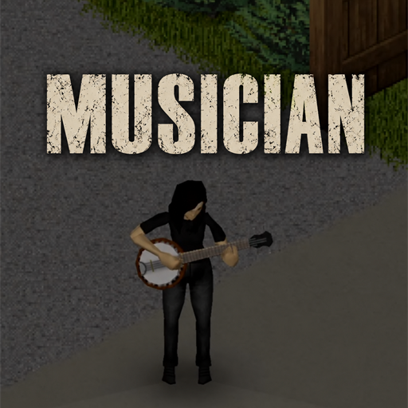

# Musician

Play Zomboid's instruments, write songs on paper, and make music with other survivors.

I wanted to actually play the instruments in Zomboid. That got a little out of hand,
and now there's a music workstation in it.

[Get Musician on Steam Workshop](https://steamcommunity.com/sharedfiles/filedetails/?id=3816180767)



## What it does

- Play equipped instruments from a MIDI keyboard or guitar controller. Placed pianos
  and drum furniture have their own performance positions.
- Write music on a sheet of paper with a piano roll and an arrangement of up to eight
  parts. You do not need an instrument or a MIDI controller to compose.
- Draw and edit notes, choose scales, quantize, undo/redo, record MIDI, use a metronome,
  and preview individual parts or the whole song privately.
- Import MIDI clips, drag chords onto a root note, move and loop phrases, and use the
  included procedural chords, progressions and drum patterns.
- Copy written music, share parts, and coordinate an ensemble start. Nearby players
  can also hear live MIDI performances. Multiplayer remains experimental.
- Load personal SF2 soundfonts or soundfont-pack mods and map presets to instruments.
- Choose Natural or Soft touch response. Recorded and transmitted MIDI velocities
  stay unchanged. Fast audio limits queued audio; actual latency still depends on
  Windows, the device driver and the rest of the audio path.

Current source snapshot: **0.13.2**, targeting **Project Zomboid Build 42.21**.
The supported audio-client setup is Windows x64. Other operating systems have not
been verified. The internal mod ID and Java package remain `DeadAir` for save and
settings compatibility.

## Playing the mod

Use the Workshop version for a ready-to-play package. Musician requires **ZombieBuddy
2.3+**, including its [one-time loader installation](https://github.com/zed-0xff/ZombieBuddy/blob/master/doc/Installation.md).
Subscribe/enable both mods and approve `DeadAir.jar` when prompted.

For live input, open **Options > Mods > Musician**, refresh the inputs, select your
controller and connect. Leave MIDI channel at **0 (all)** for a multi-channel guitar.
Equip an instrument and play. Right-click a piano or drum to take position, or blank
paper to write a song.

**F10** shows the performance panel, **F11** stops notes, and **F12** toggles playing
animations. In-world music can attract zombies; the setting is optional.

## Building from source

This repository contains the Java/Lua implementation, the modified Gervill sampler,
tests, and authoring tools. It is **not a complete replacement for the Workshop asset
package**. Borrowed animation clips, animation definitions, instrument artwork and
sound banks are not committed here. See [asset setup](docs/BUILDING.md).

You need Python 3.10+, a Java 22+ compiler (or an Eclipse ECJ compiler supporting Java
22), and local copies of Project Zomboid 42.21 and ZombieBuddy. Their binaries are
compile-time dependencies and are not redistributed.

```powershell
python build.py --game "C:\Program Files (x86)\Steam\steamapps\common\ProjectZomboid"
```

That builds `Contents/mods/DeadAir/42/media/java/client/DeadAir.jar` and copies the
sampler's corresponding source and license notices into the local output. To run
audio tests, first import the runtime assets described in [BUILDING.md](docs/BUILDING.md).

```powershell
python build.py --game "C:\Program Files (x86)\Steam\steamapps\common\ProjectZomboid" --input-test --sampler-test
python tests/lua_test.py --game "C:\Program Files (x86)\Steam\steamapps\common\ProjectZomboid"
```

The Lua tests also require `lupa` with its Lua 5.1 runtime. The commands above do not
open MIDI or audio devices. Optional hardware probes are separate flags.

## Contributing and bug reports

Bug reports and pull requests are welcome. Please include the mod/game version,
instrument, single-player or multiplayer, what you were doing, and what happened.
For live MIDI issues, include your controller model and whether F10 counts the notes.
Remove personal paths and unrelated information from log excerpts.

See [CONTRIBUTING.md](CONTRIBUTING.md) for the code layout and test workflow, and
[SOUNDFONT-PACKS.md](SOUNDFONT-PACKS.md) for soundfont-addon registration. An empty
soundfont-pack template is in [examples/soundfont-pack](examples/soundfont-pack).

## License and credits

Musician's original code is licensed under the [MIT license](LICENSE), copyright
2026 Azakaela Redfire. This includes `src/`, Musician's Lua under `Contents/`, tests,
tools, authoring scripts and documentation unless a file states otherwise.

The vendored sampler in `vendor/gervill/` retains **GPL-2.0 with the Classpath
exception** and its original notices. Imported sound banks, animations, game files
and third-party artwork are **not covered by Musician's MIT license**.

Thanks to Karl Helgason / Sun Microsystems and the Gervill contributors, S. Christian
Collins for GeneralUser GS, Aza's Playable Guitar and its B42 port, Lifestyle,
PseudonymousEd's Simple Playable Pianos, and ZombieBuddy. See [THIRD_PARTY.md](THIRD_PARTY.md)
for the component boundaries and source links.
